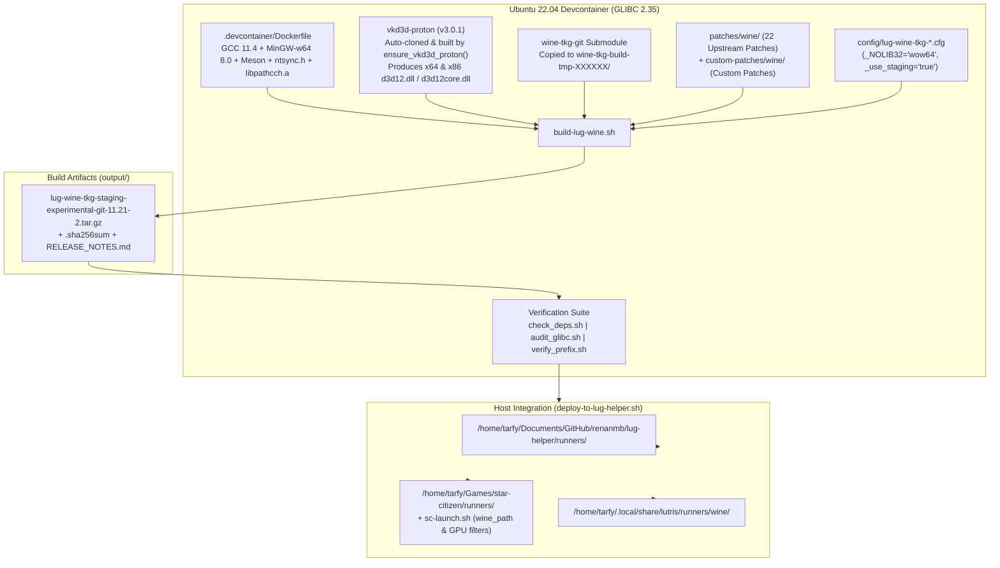

# 1. Architecture & What We Built

This document explains **what** we built in `renanmb/lug-wine-experimental` (and `renanmb/lug-helper`), **why** each customization was necessary, and **how** the end-to-end build, verification, and deployment pipeline works.

---

## 1. The Core Problem We Solved

Upstream [`starcitizen-lug/lug-wine-experimental`](https://github.com/starcitizen-lug/lug-wine-experimental) compiles its Wine runners inside an **Ubuntu 24.04** container, linking all Linux ELF binaries (`wine`, `wine64`, `wineserver`, `ntdll.so`, `winevulkan.so`, etc.) against **`glibc >= 2.39`**.
Additionally, upstream [`starcitizen-lug/lug-helper`](https://github.com/starcitizen-lug/lug-helper) enforces `required_glibc="2.39"` when installing experimental runners.

On an **Ubuntu 22.04.5 LTS** workstation (`glibc 2.35` with custom mainline kernel `7.2.9-zabbly+` and multi-GPU `NVIDIA RTX PRO 6000 Blackwell` + headless `NVIDIA-G0` + AMD iGPU):
1. Upstream pre-built runners fail immediately with `version 'GLIBC_2.38' / 'GLIBC_2.39' not found`.
2. Upstream `lug-helper` refuses to download or select `LUG Experimental` runners on GLIBC 2.35 systems.
3. Multi-GPU workstations require explicit Vulkan ICD isolation (`VK_DRIVER_FILES`) and DXVK/VKD3D device filtering (`NVIDIA RTX PRO 6000`) so Star Citizen does not pick the headless GPU, CPU iGPU, or `llvmpipe`.

---

## 2. System Architecture Overview

---

## 3. Key Components We Built

### A. Reproducible Ubuntu 22.04 (GLIBC 2.35) Build Container
Defined in [`.devcontainer/Dockerfile`](../../../.devcontainer/Dockerfile) and [`.devcontainer/devcontainer.json`](../../../.devcontainer/devcontainer.json):
- **Strictly pinned to `ubuntu:22.04`** so every compiled ELF binary links against `glibc <= 2.35`.
- **Full 64-bit & 32-bit development headers:** Vulkan, OpenGL/Mesa, X11, Wayland (`libwayland-dev`, `libxkbcommon-dev`), OpenXR (`libopenxr-dev`), GStreamer, ALSA/PulseAudio, SDL2, USB/udev, GnuTLS, and `glslang-tools`.
- **Kernel UAPI `ntsync.h`:** Fetched into `/usr/local/include/linux/ntsync.h` so Wine 11.x compiles cleanly with Ntsync headers present (while keeping `_use_ntsync="false"` at runtime when `/dev/ntsync` is absent, using native `futex_waitv` Fsync on Linux 7.2.9+).
- **MinGW-w64 `libpathcch.a` Import Libraries:** Ubuntu 22.04 ships MinGW-w64 8.0, which lacks `libpathcch.a` (needed by `vkd3d-proton` `v3.0.1`). The Dockerfile generates both 64-bit (`/usr/x86_64-w64-mingw32/lib/libpathcch.a`) and 32-bit (`/usr/i686-w64-mingw32/lib/libpathcch.a`) import libraries from `api-ms-win-core-path-l1-1-0.dll` using `dlltool`.
- **Upgraded Meson & C/C++ Intelligence:** Installs recent `meson` via `pip` (required by `vkd3d-proton` subprojects), plus `clangd`, `gdb`, and `/opt/clangd-mcp-server`.

### B. Automated Build Script (`build-lug-wine.sh`)
[`build-lug-wine.sh`](../../../build-lug-wine.sh) orchestrates the entire build in four stages:
1. **`ensure_vkd3d_proton()` ([lines 59–79](../../../build-lug-wine.sh#L59-L79)):**
   - Checks if `vkd3d-proton/build/vkd3d-proton-master/{x64,x86}/d3d12.dll` exist.
   - If missing (e.g., on a fresh clone), it automatically clones `https://github.com/HansKristian-Work/vkd3d-proton.git` at tag `v3.0.1` (`--depth 1 --recursive`), patches `PATHCCH_NONE` to `0` in `libs/vkd3d-common/platform.c` for MinGW 8.0 compatibility, and builds the 64-bit and 32-bit DirectX 12 PE DLLs (`d3d12.dll` and `d3d12core.dll`).
2. **`prepare_preset()` ([lines 106–164](../../../build-lug-wine.sh#L106-L164)):**
   - Selects one of the 4 configs in [`config/`](../../../config/lug-wine-tkg-staging-default.cfg) (`default`, `staging-default`, `wayland`, `staging-wayland`), all configured with **New-WoW64 (`_NOLIB32="wow64"`)** so 32-bit Windows PE applications run via thunking into 64-bit Unix `.so` libraries without needing 32-bit host Linux runtime libraries.
   - Copies `wine-tkg-git/wine-tkg-git` into an isolated temporary folder (`wine-tkg-build-tmp-XXXXXX/`).
   - Copies the **22 Star Citizen LUG patches** from [`patches/wine/`](../../../patches/README.md) (allowing same-named files in [`custom-patches/wine/`](../../../custom-patches/wine/README.md) to override them) plus any additional `custom-patches/wine/*.patch` files into `./wine-tkg-userpatches/*.mypatch`.
3. **`build_lug_wine()` & `post_build_add_overrides()` ([lines 166–173](../../../build-lug-wine.sh#L166-L173)):**
   - Runs Wine-TKG's `non-makepkg-build.sh`.
   - Stamps `vkd3d-proton`'s `x64` and `x86` `d3d12.dll` and `d3d12core.dll` with `winebuild --builtin` and installs them directly into `lib/wine/x86_64-windows/` and `lib/wine/i386-windows/`.
4. **`package_artifact()` ([lines 175–192](../../../build-lug-wine.sh#L175-L192)):**
   - Packages the finished runner into `output/lug-wine-tkg-<preset>-git-<version>-<rev>.tar.gz` and cleans up the temporary build directory on exit.

### C. Verification & Auditing Suite (`.agents/skills/`)
Six automated skills in [`.agents/skills/`](../../skills/README.md) verify every stage of the build:
1. **[`check_deps.sh`](../../skills/ubuntu-2204-build-environment-provisioner/scripts/check_deps.sh):** Verifies 19 build tools, compilers (`gcc`, `x86_64-w64-mingw32-gcc`, `i686-w64-mingw32-gcc`), headers (`ntsync.h`), and `pkg-config` libraries.
2. **[`audit_config.sh`](../../skills/tkg-config-auditor/scripts/audit_config.sh):** Audits `config/*.cfg` against upstream Wine-TKG templates and confirms `_NOLIB32="wow64"` and `_use_ntsync="false"`.
3. **[`validate_patches.sh`](../../skills/wine-patch-validator/scripts/validate_patches.sh):** Validates patch syntax across `patches/wine/*.patch` and `custom-patches/wine/*.patch`.
4. **[`audit_glibc.sh`](../../skills/glibc-compatibility-auditor/scripts/audit_glibc.sh):** Inspects all 48 ELF binaries and `.so` libraries inside the built runner to guarantee **zero symbols exceed `GLIBC_2.35`**.
5. **[`verify_prefix.sh`](../../skills/eac-and-prefix-verifier/scripts/verify_prefix.sh):** Bootstraps an ephemeral headless Wine prefix (`WINEDLLOVERRIDES="mscoree,mshtml=d"`) and verifies:
   - `system32` and `syswow64` creation (WoW64 working),
   - `HideWineExports="Y"` for `starcitizen.exe` in `user.reg`,
   - EAC dummy DLLs (`devobj.dll`, `drvstore.dll`),
   - VKD3D-Proton DLLs (`d3d12.dll`, `d3d12core.dll`) in both 64-bit and 32-bit directories,
   - Clean execution of both `wine` and `wine64` (`cmd /c`).

### D. Automated Deployment (`deploy-to-lug-helper.sh`) & LUG Helper Integration
[`deploy-to-lug-helper.sh`](../../../deploy-to-lug-helper.sh) takes the latest `output/lug-wine-*.tar.gz` archive, verifies/generates its `.sha256sum`, fixes `tarfy:tarfy` file ownership when executed as `root` inside the devcontainer, and deploys it to three locations:
1. `/home/tarfy/Documents/GitHub/renanmb/lug-helper/runners/` (mounted at `/lug-helper` in the devcontainer)
2. `/home/tarfy/Games/star-citizen/runners/` (updating `export wine_path=...` in `/home/tarfy/Games/star-citizen/sc-launch.sh`)
3. `/home/tarfy/.local/share/lutris/runners/wine/`
