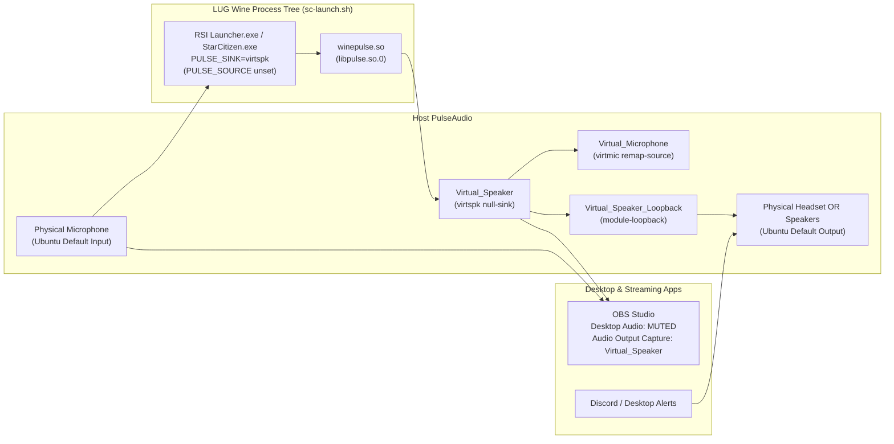

# 4. Audio Configuration, Virtual Cable Isolation & OBS Streaming Guide

This guide documents how audio works in **`renanmb/lug-wine-experimental`**, how to isolate Star Citizen game audio onto a PulseAudio virtual cable (`Virtual_Speaker` / `virtspk`) for clean **OBS Studio** streaming and recording, and how to listen to the game on either **headphones** or **physical speakers** (with or without virtual cables active).

For the cross-repository handoff specification from `Virtual-Cables-Linux`, see [`virtual_cable_audio_isolation_and_sc_launch_integration.md`](../notes/virtual_cable_audio_isolation_and_sc_launch_integration.md).

---

## 1. Audio Architecture Overview

### Host & Wine Runner Stack (Ubuntu 22.04.5 LTS)
1. **Host Audio Server**:
   - Ubuntu 22.04.5 LTS runs **PulseAudio** (`pactl info` $\rightarrow$ `Server Name: pulseaudio`; `pipewire-pulse` is inactive).
   - Virtual audio cables are managed on the host by `/home/tarfy/Documents/GitHub/renanmb/Virtual-Cables-Linux/virtual-cables-pulseaudio.sh`.
2. **Wine Runner Audio Backend (`lug-wine-experimental` `11.22-2+`)**:
   - Windows audio APIs (`mmdevapi.dll`) call into `lib/wine/x86_64-unix/winepulse.so`, dynamically linked against host `/lib/x86_64-linux-gnu/libpulse.so.0` (GLIBC 2.35).
   - Prefix audio endpoints are tracked under `[Software\\Wine\\Drivers\\winepulse.drv\\devices\\...]` in `/home/tarfy/Games/star-citizen/user.reg`.
   - No Wine recompilation is required to turn virtual-cable routing on or off—routing is controlled per process at launch via `PULSE_SINK`.

### End-to-End Signal Flow



### Why `PULSE_SINK=virtspk` Beats Manual `pavucontrol` Routing
PulseAudio's `module-stream-restore` remembers per-application sink assignments using generic Wine loader binary names (such as `wine64-preloader`), which can unintentionally drag unrelated Wine prefixes or launchers into `Virtual_Speaker`. Exporting `PULSE_SINK=virtspk` inside `/home/tarfy/Games/star-citizen/sc-launch.sh` scopes virtual-cable routing strictly to the `RSI Launcher.exe` + `StarCitizen.exe` process tree from startup.

---

## 2. Three Mandatory Audio Rules

> [!IMPORTANT]
> Violating any of these three invariants causes silent game launches, desktop audio bleed into OBS, or in-game VOIP feedback loops.

1. **Never set `PULSE_SINK=virtspk` without ensuring `virtspk` exists first**:
   - PulseAudio virtual modules are session-ephemeral and reset on every host reboot. If `PULSE_SINK=virtspk` is set when `virtspk` is absent, `libpulse` fails `pa_stream_connect_playback()` (`No such entity`) and Star Citizen launches **completely silent**.
   - Always run `virtual-cables-pulseaudio.sh` (which is idempotent and exits `0` immediately if `virtspk` is already loaded) before exporting `PULSE_SINK="virtspk"`.
2. **Always leave `PULSE_SOURCE` unset in `sc-launch.sh`**:
   - Never set `PULSE_SOURCE=virtmic` for Wine. Leaving `PULSE_SOURCE` unset keeps your real physical microphone connected to Star Citizen's in-game VOIP (proximity and party voice chat) instead of feeding game audio back into your mic input.
3. **Keep Ubuntu Global Output & In-Game Audio Output on Default**:
   - In **Ubuntu Settings $\rightarrow$ Sound $\rightarrow$ Output Device**, always select your **physical headset or physical speakers**—**never** select `Virtual_Speaker` as the global system output (otherwise Discord voices, browser audio, and desktop notifications will enter `virtspk` and be broadcast on OBS).
   - Inside **Star Citizen $\rightarrow$ Options $\rightarrow$ Audio**, leave **Audio Output Device** set to **Default / System Default** so `winepulse.so` honors `PULSE_SINK=virtspk`.

---

## 3. Launching Star Citizen Isolated onto `virtspk`

> [!NOTE]
> Always run audio/game launch commands on the **Linux host** (never inside the isolated build devcontainer, which does not share the host PulseAudio socket).

### Option A: One-Off Host Terminal Launch (No File Edits)
```bash
/home/tarfy/Documents/GitHub/renanmb/Virtual-Cables-Linux/virtual-cables-pulseaudio.sh >/dev/null && \
  PULSE_SINK=virtspk /home/tarfy/Games/star-citizen/sc-launch.sh
```

### Option B: Automatic & Toggleable Integration in `sc-launch.sh` (Recommended)
Place the guarded `SC_VIRTUAL_CABLE` block inside the `# ENVIRONMENT VARIABLES` section of `/home/tarfy/Games/star-citizen/sc-launch.sh`:

```bash
# Virtual audio cable isolation (1 = route game audio to Virtual_Speaker / virtspk, 0 = normal desktop audio)
export SC_VIRTUAL_CABLE="${SC_VIRTUAL_CABLE:-1}"
VIRTUAL_CABLE_SCRIPT="/home/tarfy/Documents/GitHub/renanmb/Virtual-Cables-Linux/virtual-cables-pulseaudio.sh"
if [ "${SC_VIRTUAL_CABLE}" = "1" ] && [ -x "${VIRTUAL_CABLE_SCRIPT}" ]; then
    if "${VIRTUAL_CABLE_SCRIPT}" >/dev/null 2>&1; then
        export PULSE_SINK="virtspk"
    fi
fi
unset VIRTUAL_CABLE_SCRIPT
```

- **Standard isolated launch**: `/home/tarfy/Games/star-citizen/sc-launch.sh` (or your desktop shortcut) automatically initializes `virtspk` after a reboot and isolates Star Citizen audio.
- **One-off bypass (normal desktop audio)**: `SC_VIRTUAL_CABLE=0 /home/tarfy/Games/star-citizen/sc-launch.sh`.
- **Deployment persistence**: [`deploy-to-lug-helper.sh`](../../../deploy-to-lug-helper.sh#L98-L105) preserves custom environment variables in `sc-launch.sh` when updating `export wine_path=...`, and can also seed this block idempotently alongside the Vulkan `GraphicsRenderer = 1` configuration.

### Option C: Lutris Runner Configuration
If launching via Lutris (`~/.local/share/lutris/runners/wine`):
1. Right-click **Star Citizen** $\rightarrow$ **Configure** $\rightarrow$ **System options**.
2. **Pre-launch script**: `/home/tarfy/Documents/GitHub/renanmb/Virtual-Cables-Linux/virtual-cables-pulseaudio.sh` (enable **Wait for pre-launch script completion**).
3. **Environment variables**: Add key `PULSE_SINK` = `virtspk`.

---

## 4. OBS Studio Streaming & Recording Setup

Once Star Citizen is routed to `virtspk`, configure OBS Studio so it records/streams **only** game audio plus your microphone:

1. **Disable Global Desktop Audio**:
   - Open OBS **Settings $\rightarrow$ Audio** $\rightarrow$ under **Global Audio Devices**, set **Desktop Audio** (and Desktop Audio 2) to **Disabled** (or mute `Desktop Audio` in the Audio Mixer).
   - *Why*: `Desktop Audio` captures your physical headset/speakers, which carries Discord voices, system notifications, **and** the `Virtual_Speaker_Loopback` copy of the game.
2. **Add Isolated Star Citizen Audio Source**:
   - In your Scene's **Sources** panel, click **`+`** $\rightarrow$ **Audio Output Capture (PulseAudio)** (name it e.g. `Star Citizen Audio`).
   - Set **Device** to **`Virtual_Speaker`** (`virtspk`).
   - *(Alternative)*: You can also use **Audio Input Capture (PulseAudio)** $\rightarrow$ **`Virtual_Microphone`** (`virtmic`). Using `Virtual_Microphone` is also how you share game audio as a mic input in **Discord / Zoom / Jitsi**.
3. **Configure OBS Audio Monitoring (Avoid Double Audio)**:
   - In OBS **Audio Mixer**, click the gear icon next to `Star Citizen Audio` $\rightarrow$ **Advanced Audio Properties**.
   - Leave **Audio Monitoring** set to **`Monitor Off`**, because `Virtual_Speaker_Loopback` already plays the game into your headset/speakers with lower latency than OBS.
   - *If you prefer monitoring inside OBS* (for example, to hear OBS compressor/ducking filters locally), disable the PulseAudio loopback so you do not hear the game twice:
     ```bash
     /home/tarfy/Documents/GitHub/renanmb/Virtual-Cables-Linux/virtual-cables-pulseaudio.sh restart --no-loopback
     ```
4. **Configure Your Microphone**:
   - Keep OBS **Settings $\rightarrow$ Audio $\rightarrow$ Mic/Aux** pointed to your real physical microphone (never `Virtual_Microphone`).

---

## 5. Listening on Physical Speakers vs. Headset

You do **not** lose local audio when Star Citizen is routed to `Virtual_Speaker`. How you listen on your physical speakers depends on whether you are actively isolating audio for OBS or playing normally:

### Case 1: Listen on Speakers **While Isolating Audio for OBS**
`virtual-cables-pulseaudio.sh` automatically loads **`Virtual_Speaker_Loopback`**, which forwards `Virtual_Speaker` (`virtspk`) to your physical output device in real time while OBS captures the clean `Virtual_Speaker` feed upstream:

```text
StarCitizen.exe ──► Virtual_Speaker (virtspk) ──┬──► OBS Studio (clean game-only audio)
                                                └──► Virtual_Speaker_Loopback ──► Your Physical Speakers
```

To listen on your physical speakers instead of your headset:
1. **Switch Ubuntu's Global Output to Your Speakers**:
   - Open **Ubuntu Settings $\rightarrow$ Sound $\rightarrow$ Output Device** and select your physical speakers (e.g., USB/Analog speakers or HDMI monitor speakers).
   - *Reminder*: Never select `Virtual_Speaker` here—keep Ubuntu's global output on the physical device you want your ears to hear.
2. **If You Switched Devices While the Virtual Cable Was Already Running**:
   Choose either method to move the loopback stream onto your speakers:
   - **Option 1 — Refresh the virtual cable script**:
     ```bash
     /home/tarfy/Documents/GitHub/renanmb/Virtual-Cables-Linux/virtual-cables-pulseaudio.sh restart
     ```
   - **Option 2 — Move it live in `pavucontrol` (no restart, supports split routing)**:
     1. Open `pavucontrol` $\rightarrow$ **Playback** tab.
     2. Change the bottom filter dropdown from *Show: Applications* to **`Show: All Streams`** (PulseAudio hides loopback modules under *Applications* by default).
     3. Locate **`Loopback from Virtual_Speaker`** and select your physical speakers from its output dropdown.
     > [!TIP]
     > Using `pavucontrol` (*Show: All Streams*) lets you split devices independently—for example, keeping **Discord voice chat in your USB headset** while playing **Star Citizen out of your physical speakers** (or vice versa), all while OBS still receives only clean Star Citizen audio from `Virtual_Speaker`.

> [!TIP]
> **Using Open Speakers With an Active Stream Microphone:** Because open room speakers radiate sound into the air, enable OBS's **Noise Suppression (`RNNoise`)** or a **Noise Gate** filter on your `Mic/Aux` channel in OBS so speaker audio in the room is not picked up acoustically by your microphone.

### Case 2: Listen on Speakers **Without Virtual Cables** (Normal Non-Streaming Play)
When you are not using OBS and simply want Star Citizen connected directly to your desktop speakers:
- **At game launch** (with `SC_VIRTUAL_CABLE` configured in `sc-launch.sh`):
  ```bash
  SC_VIRTUAL_CABLE=0 /home/tarfy/Games/star-citizen/sc-launch.sh
  ```
- **Live mid-game without restarting Star Citizen**:
  1. Open `pavucontrol` $\rightarrow$ **Playback** tab (*Show: Applications*).
  2. Change **`StarCitizen.exe`** from `Virtual_Speaker` directly to your physical speakers (and switch it back to `Virtual_Speaker` whenever you start OBS).

---

## 6. Build & Smoke-Test Guardrails in `lug-wine-experimental`

To guarantee future custom GLIBC 2.35 Wine builds never silently drop PulseAudio support (`winepulse.so`), `lug-wine-experimental` maintains four layers of build/test guardrails:

1. **Container & Host Dependency Provisioning**:
   - [`.devcontainer/Dockerfile`](../../../.devcontainer/Dockerfile#L89) installs `libpulse-dev` and `libpulse-dev:i386`.
   - [`check_deps.sh`](../../skills/ubuntu-2204-build-environment-provisioner/scripts/check_deps.sh#L68) verifies `pkg-config --exists libpulse` (`libpulse-dev`).
2. **Build Script Preflight ([`build-lug-wine.sh`](../../../build-lug-wine.sh#L59-L73))**:
   - `verify_host_headers()` checks `pkg-config` modules before compilation begins so missing PulseAudio development headers fail fast instead of letting `./configure` omit `winepulse.so`.
3. **Wine-TKG Preset Configure Flags**:
   - [`config/lug-wine-tkg-staging-default.cfg`](../../../config/lug-wine-tkg-staging-default.cfg#L158-L160) (along with [`lug-wine-tkg-default.cfg`](../../../config/lug-wine-tkg-default.cfg#L158-L160), [`lug-wine-tkg-staging-wayland.cfg`](../../../config/lug-wine-tkg-staging-wayland.cfg#L158-L160), and [`lug-wine-tkg-wayland.cfg`](../../../config/lug-wine-tkg-wayland.cfg#L158-L160)) passes explicit configure flags (`--with-pulse`) in `_configure_userargs64` and `_configure_userargs32`.
4. **Automated Runner Smoke Test ([`verify_prefix.sh`](../../skills/eac-and-prefix-verifier/scripts/verify_prefix.sh))**:
   - Verifies that `lib/wine/x86_64-unix/winepulse.so` is present in the packaged runner and dynamically linked against `libpulse.so.0`.

---

## 7. Quick Verification & Troubleshooting Checklist

### Verify Active Virtual Cables & Routing
```bash
# 1. Check virtual sink, virtual mic, and loopback status on the host
/home/tarfy/Documents/GitHub/renanmb/Virtual-Cables-Linux/virtual-cables-pulseaudio.sh status

# 2. Confirm StarCitizen.exe sink assignment in PulseAudio
pactl list sink-inputs
```
In `pavucontrol`:
- **Playback** (*Show: Applications*) $\rightarrow$ `StarCitizen.exe` / `RSI Launcher.exe` is routed to **`Virtual_Speaker`**, while browsers/Discord remain on your physical headset or speakers.
- **Playback** (*Show: All Streams*) $\rightarrow$ `Loopback from Virtual_Speaker` is routed to the physical headset or speakers you want to listen on.
- **Input Devices** (*Show: All Input Devices*) $\rightarrow$ **`Virtual_Microphone`** meter bounces with Star Citizen audio.

### Common Issues & Fixes

| Symptom | Cause | Fix |
| :--- | :--- | :--- |
| **Star Citizen launches completely silent** | `PULSE_SINK=virtspk` was exported after a reboot without loading `virtspk` first, or `Loopback from Virtual_Speaker` is muted/pointed at an off device | Run `/home/tarfy/Documents/GitHub/renanmb/Virtual-Cables-Linux/virtual-cables-pulseaudio.sh` (or `restart`), and check `pavucontrol` $\rightarrow$ *Playback* (*Show: All Streams*) |
| **Discord / desktop notifications are heard on OBS stream** | OBS `Desktop Audio` is still unmuted, OR Ubuntu global Sound Output was set to `Virtual_Speaker` | Mute/disable `Desktop Audio` in OBS, and set Ubuntu Sound Settings Output back to your physical headset or speakers |
| **Double / echoed game audio in headphones or speakers** | Both `Virtual_Speaker_Loopback` AND OBS `Monitor and Output` are active simultaneously | Set OBS `Star Citizen Audio` monitoring to **Monitor Off**, OR run `virtual-cables-pulseaudio.sh restart --no-loopback` |
| **Other players in Star Citizen VOIP hear game audio instead of your voice** | `PULSE_SOURCE=virtmic` was exported in the launch environment | Remove `PULSE_SOURCE` from `sc-launch.sh` so Wine uses your physical default microphone |
| **Switched from headset to speakers, but game is still playing in headset** | Existing `Virtual_Speaker_Loopback` stream stayed bound to the previous sink | Run `virtual-cables-pulseaudio.sh restart` OR switch `Loopback from Virtual_Speaker` to your speakers in `pavucontrol` (*Show: All Streams*) |
