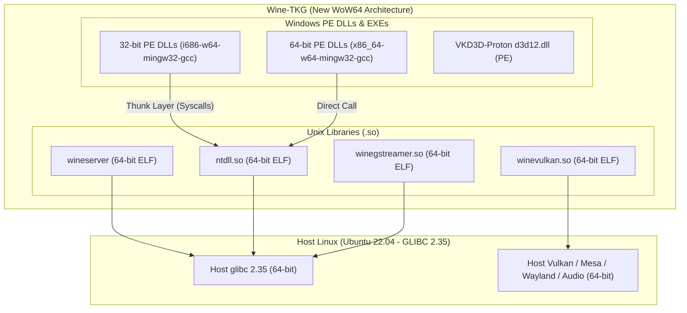
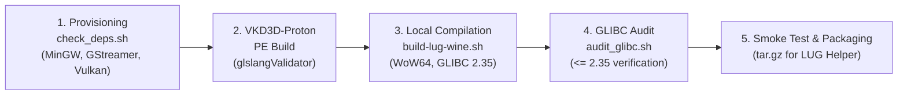

# Roadmap & Technical Specification: Building GLIBC 2.35 Compatible Wine-TKG Runners

## 1. Goal & Context

**Objective**: Create, verify, and package a standalone version of the **LUG-Wine-TKG runner** tailored for Star Citizen that runs natively on **Ubuntu 22.04.5 LTS** (GLIBC 2.35) and is optimized for the host system's **`7.2.9-zabbly+` custom kernel**.

### The Technical Problem
Upstream CI builds in [`.github/workflows/build-artifacts.yml`](file:///workspaces/lug-wine-experimental/.github/workflows/build-artifacts.yml) are pinned to **`ubuntu:24.04`**, producing binaries tied to **`glibc >= 2.39`**. Because GNU C Library (`glibc`) symbols are backward-compatible but **strictly not forward-compatible**, those release binaries fail to execute on systems with `glibc 2.35`, crashing on startup with missing symbol errors (e.g., `version GLIBC_2.38 not found`).

To deliver a functioning runner for this system, we must establish a build pipeline that compiles the runner and companion libraries against **GLIBC <= 2.35**, while taking full advantage of the kernel features in `7.2.9-zabbly+` (such as `futex_waitv` for Fsync and `PREEMPT_DYNAMIC`).

---

## 2. Host System Profile & Kernel Capability Analysis

| Component | Host Specification | Wine / Runner Relevance |
| :--- | :--- | :--- |
| **Operating System** | Ubuntu 22.04.5 LTS (Jammy Jellyfish) | Sets the baseline GLIBC runtime (`2.35-0ubuntu3.14`). |
| **Linux Kernel** | `7.2.9-zabbly+ #ubuntu22.04 SMP PREEMPT_DYNAMIC` | Modern mainline kernel supporting `futex_waitv` (Fsync / futex2 syscall 449). |
| **Host GLIBC** | **2.35** | Maximum allowable symbol version for all host ELF binaries and `.so` Unix libraries. |
| **Host Compiler** | GCC 11.4.0 (`Ubuntu 11.4.0-1ubuntu1~22.04`) | More forgiving than GCC 14 with implicit declarations; builds cleanly with `-Wno-error=implicit-function-declaration`. |
| **MinGW-w64** | MinGW-w64 8.0.0 (`10.3.0-14ubuntu1+24.3`) | Cross-compiles PE `.dll` and `.exe` binaries for WoW64 (`x86_64` and `i686`). |

### Kernel Feature Details
1. **Fsync (`futex_waitv`) Support**:
   - The `7.2.9-zabbly+` kernel includes native support for `futex_waitv` (standard since Linux 5.16).
   - When Wine is built with Fsync or Wine-Staging futex patches, setting `WINEFSYNC=1` allows high-performance synchronization without kernel-level eventfd bottlenecks.
2. **Ntsync Status & Safety**:
   - Upstream kernel UAPI header [`ntsync.h`](file:///usr/local/include/linux/ntsync.h) is installed in `/usr/local/include/linux/ntsync.h` to satisfy compilation dependencies.
   - However, `/dev/ntsync` is not exposed in the devcontainer environment.
   - **Crucial Rule**: Keep `_use_ntsync="false"` in [`config/lug-wine-tkg-*.cfg`](file:///workspaces/lug-wine-experimental/config) to prevent runtime failures when `/dev/ntsync` is absent.

---

## 3. Inventory of Equipped Skills & MCP Servers

### Agent Skills
The following specialized skills in [`.agents/skills/`](file:///workspaces/lug-wine-experimental/.agents/skills/) are active:

| Skill | Path | Objective & Script |
| :--- | :--- | :--- |
| [**`glibc-compatibility-auditor`**](file:///workspaces/lug-wine-experimental/.agents/skills/glibc-compatibility-auditor/SKILL.md) | [`.agents/skills/glibc-compatibility-auditor/`](file:///workspaces/lug-wine-experimental/.agents/skills/glibc-compatibility-auditor) | Uses [`audit_glibc.sh`](file:///workspaces/lug-wine-experimental/.agents/skills/glibc-compatibility-auditor/scripts/audit_glibc.sh) to inspect all ELF `.so` libraries and verify symbol versions do not exceed `GLIBC_2.35`. |
| [**`ubuntu-2204-build-environment-provisioner`**](file:///workspaces/lug-wine-experimental/.agents/skills/ubuntu-2204-build-environment-provisioner/SKILL.md) | [`.agents/skills/ubuntu-2204-build-environment-provisioner/`](file:///workspaces/lug-wine-experimental/.agents/skills/ubuntu-2204-build-environment-provisioner) | Uses [`check_deps.sh`](file:///workspaces/lug-wine-experimental/.agents/skills/ubuntu-2204-build-environment-provisioner/scripts/check_deps.sh) to verify 19 tools and development packages including MinGW-w64 (`x86_64` & `i686`), GStreamer, Vulkan, OpenXR, Wayland, and `ntsync.h`. |
| [**`vkd3d-proton-glibc235-builder`**](file:///workspaces/lug-wine-experimental/.agents/skills/vkd3d-proton-glibc235-builder/SKILL.md) | [`.agents/skills/vkd3d-proton-glibc235-builder/`](file:///workspaces/lug-wine-experimental/.agents/skills/vkd3d-proton-glibc235-builder) | Instructions to build VKD3D-Proton DirectX 12 PE DLLs under Ubuntu 22.04 with MinGW-w64 8.0 compatibility workarounds (`PATHCCH_NONE`). |
| [**`c-build-and-patch-debugger`**](file:///workspaces/lug-wine-experimental/.agents/skills/c-build-and-patch-debugger/SKILL.md) | [`.agents/skills/c-build-and-patch-debugger/`](file:///workspaces/lug-wine-experimental/.agents/skills/c-build-and-patch-debugger) | Triages GCC 11 compilation flags, Wine `.spec` export alignment, and patch conflicts. |
| [**`wine-patch-validator`**](file:///workspaces/lug-wine-experimental/.agents/skills/wine-patch-validator/SKILL.md) | [`.agents/skills/wine-patch-validator/`](file:///workspaces/lug-wine-experimental/.agents/skills/wine-patch-validator) | Uses [`validate_patches.sh`](file:///workspaces/lug-wine-experimental/.agents/skills/wine-patch-validator/scripts/validate_patches.sh) to test syntax of all 34 community patches in [`patches/wine/`](file:///workspaces/lug-wine-experimental/patches/wine). |
| [**`tkg-config-auditor`**](file:///workspaces/lug-wine-experimental/.agents/skills/tkg-config-auditor/SKILL.md) | [`.agents/skills/tkg-config-auditor/`](file:///workspaces/lug-wine-experimental/.agents/skills/tkg-config-auditor) | Uses [`audit_config.sh`](file:///workspaces/lug-wine-experimental/.agents/skills/tkg-config-auditor/scripts/audit_config.sh) to ensure `_NOLIB32="wow64"` is configured across all presets. |

### Active MCP Servers
Configured in [`.agents/mcp_config.json`](file:///workspaces/lug-wine-experimental/.agents/mcp_config.json):
- **`clangd`**: Semantic AST navigation, header resolution, diagnostics for C codebase.
- **`debugger`**: Attaches GDB 12.1 for backtraces and crash diagnostics.
- **`git`**: Scoped git repository inspection.
- **`filesystem`**: Scoped file inspection and directory management.

---

## 4. Technical Architecture: WoW64 vs 32-bit Multilib



### Why New-WoW64 Solves the Ubuntu 22.04 Compatibility Problem
- **The Old Multilib Dilemma**: Compiling traditional 32-bit Wine on Ubuntu requires installing dozens of `:i386` development packages (e.g., `libvulkan-dev:i386`, `libgl1-mesa-dev:i386`), which constantly conflict with their `:amd64` counterparts in `apt`.
- **The New-WoW64 Solution**: By setting `_NOLIB32="wow64"`, Wine's configure script uses `--enable-archs=i386,x86_64`.
  - All 64-bit Unix modules (`.so`) link against the host 64-bit GLIBC 2.35.
  - All 32-bit Windows binaries (`.dll`, `.exe`) are cross-compiled as PE files using `i686-w64-mingw32-gcc`.
  - At runtime, 32-bit Windows system calls are thunked internally to the 64-bit Unix subsystem.
  - **Result**: Zero 32-bit Linux host shared libraries are required, completely bypassing 32-bit multilib package conflicts!

---

## 5. End-to-End Build & Verification Workflow



### Step 1: System Toolchain & Package Verification
Run the provisioner check to confirm all 19 build dependencies:
```bash
.agents/skills/ubuntu-2204-build-environment-provisioner/scripts/check_deps.sh
```
Mandatory packages on Ubuntu 22.04:
- `build-essential`, `flex`, `bison`, `autoconf`, `pkg-config`, `ccache`
- `mingw-w64` (`x86_64-w64-mingw32-gcc` and `i686-w64-mingw32-gcc`)
- `libgstreamer1.0-dev`, `libgstreamer-plugins-base1.0-dev`
- `libvulkan-dev`, `libopenxr-dev`, `libwayland-dev`, `libxkbcommon-dev`
- `libasound2-dev`, `libpulse-dev`
- `glslang-tools` (`glslangValidator`), `meson`, `ninja-build`
- Kernel UAPI header in `/usr/local/include/linux/ntsync.h`

### Step 2: Build or Integrate VKD3D-Proton (DirectX 12 PE)
1. Ensure `glslangValidator`, `meson`, and `ninja` are available.
2. Clone VKD3D-Proton:
   ```bash
   git clone --depth 1 --recursive https://github.com/HansKristian-Work/vkd3d-proton.git
   cd vkd3d-proton
   ```
3. Apply MinGW-w64 8.0 compatibility fix in `libs/vkd3d-common/platform.c`:
   ```bash
   sed -i 's/PATHCCH_NONE/0/g' libs/vkd3d-common/platform.c
   ```
4. Build PE binaries:
   ```bash
   ./package-release.sh master build --no-package
   ```
5. Confirm output in `build/vkd3d-proton-master/x64/` and `x86/` contains `d3d12.dll` and `dxgi.dll`.

### Step 3: Compile Runner Locally with Wine-TKG
Execute [`build-lug-wine.sh`](file:///workspaces/lug-wine-experimental/build-lug-wine.sh) specifying the target preset and version matching the rebased patches (Wine 11.19):
```bash
./build-lug-wine.sh --preset default --version 11.19 --revision 1 -d ./vkd3d-proton/build/vkd3d-proton-master
```
Key Build Behaviors:
- Wine-TKG clones Wine 11.19 into temporary build directory `wine-tkg-build-tmp-XXXXXX`.
- Applies Wine-Staging patches (if staging preset is selected).
- Applies all 21 LUG user patches from [`patches/wine/`](file:///workspaces/lug-wine-experimental/patches/wine) (including [`10.2+_eac_fix.patch`](file:///workspaces/lug-wine-experimental/patches/wine/10.2+_eac_fix.patch) for EAC `wine64` loader compatibility).
- Automatically links Unix libraries against host `libc.so.6` (**GLIBC 2.35**).
- Copies VKD3D-Proton PE DLLs and registers them as Wine builtins using `winebuild --builtin`.
- Packages artifact into `output/lug-wine-*.tar.gz`.

### Step 4: Validate GLIBC Symbol Compliance
Verify that zero ELF binaries or shared libraries require symbols newer than GLIBC 2.35:
```bash
# Audit unpacked runner directory or extracted tarball
.agents/skills/glibc-compatibility-auditor/scripts/audit_glibc.sh ./output/ 2.35
```
Success criteria:
- Every `.so` Unix library (`lib/wine/x86_64-unix/*.so`) reports required symbol version `<= GLIBC_2.35`.
- Binaries in `bin/` (`wineserver`, `wine`, `wine64`) report symbol version `<= GLIBC_2.35`.
- Windows PE `.dll` files in `lib/wine/x86_64-windows/` and `i386-windows/` are ignored by ELF checks (they execute in Wine's Windows PE subsystem).

### Step 5: CI Matrix Adaptation (Optional Release Automation)
To automate community releases without local CPU consumption, expand [`.github/workflows/build-artifacts.yml`](file:///workspaces/lug-wine-experimental/.github/workflows/build-artifacts.yml):
```yaml
strategy:
  matrix:
    include:
      - os: ubuntu
        image: ubuntu:22.04
        tag_suffix: "-ubuntu2204"
        preset: default
      - os: ubuntu
        image: ubuntu:24.04
        tag_suffix: "-ubuntu2404"
        preset: default
```
This produces dual runner releases:
- `lug-wine-*-ubuntu2204.tar.gz` (compatible with GLIBC 2.35+, Ubuntu 22.04, Debian 12, SteamOS, Mint).
- `lug-wine-*-ubuntu2404.tar.gz` (compatible with GLIBC 2.39+, Ubuntu 24.04, Fedora 40+, Arch).

---

## 6. Gap Resolution Matrix

| Area | Potential Risk / Gap | Resolved State & Mitigations |
| :--- | :--- | :--- |
| **GStreamer Dependency** | `--with-gstreamer` fails configure if dev packages are missing | Installed `libgstreamer1.0-dev` & `libgstreamer-plugins-base1.0-dev`; integrated into `check_deps.sh` and `.devcontainer/Dockerfile`. |
| **Cross-Compiler** | WoW64 requires both 64-bit and 32-bit MinGW cross compilers | Installed both `x86_64-w64-mingw32-gcc` and `i686-w64-mingw32-gcc`; added to `check_deps.sh`. |
| **VKD3D-Proton Shader Compiler** | Meson fails without `glslangValidator` | Installed `glslang-tools`; added check in `check_deps.sh`. |
| **VKD3D-Proton MinGW 8.0 Bug** | `PATHCCH_NONE` undeclared in MinGW 8.0 headers on Ubuntu 22.04 | Handled via `sed -i 's/PATHCCH_NONE/0/g'` documented in `vkd3d-proton-glibc235-builder`. |
| **Ntsync Compatibility** | Kernel 7.2.9 lacks `/dev/ntsync` in devcontainer | Header provided in `/usr/local/include/linux/ntsync.h`; `_use_ntsync="false"` kept in config to avoid runtime failures. |
| **Fsync Compatibility** | Kernel 7.2.9 supports `futex_waitv` (Linux 5.16+) | Host kernel natively supports Fsync syscall 449; works automatically when `WINEFSYNC=1` is passed to the runner. |
| **EAC Loader Compatibility** | WoW64 typically outputs single `wine` binary; EAC requires `wine64` | Addressed by [`10.2+_eac_fix.patch`](file:///workspaces/lug-wine-experimental/patches/wine/10.2+_eac_fix.patch) and Wine-TKG WoW64 symlink generation. |
| **Wine Version Alignment** | Incompatible Wine versions cause patch rejects | Aligned build baseline to Wine **11.19** matching submodule commit [`01a904b`](file:///workspaces/lug-wine-experimental/patches). |
| **Build Directory Trapping** | `build-lug-wine.sh` removes temporary build tree on exit | Documented that build logs should be observed with `_log_errors_to_file="true"` if debugging compiler issues. |
