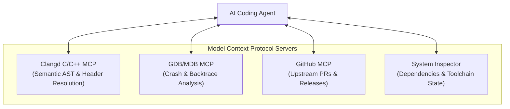
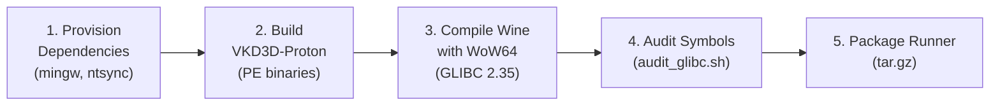

# Roadmap: Building GLIBC 2.35 Compatible Wine-TKG Runners

## 1. Goal & Context

**Objective**: Create, verify, and package a version of the **LUG-Wine-TKG runner** tailored for Star Citizen that supports **GLIBC 2.35** on the current **Ubuntu 22.04.5 LTS** system running the **`7.2.9-zabbly+` custom kernel**.

### The Technical Problem
Upstream CI builds are pinned to **Ubuntu 24.04** in `.github/workflows/build-artifacts.yml`, producing binaries tied to **`glibc >= 2.39`**. Because glibc is not forward-compatible, those release binaries fail to load on systems with `glibc 2.35`.

To deliver a working runner for this system, we must establish a build pipeline that compiles the runner and companion libraries against **GLIBC <= 2.35**, while leveraging the kernel features of `7.2.9-zabbly+` (such as Fsync/futex2 and PREEMPT_DYNAMIC).

---

## 2. Inventory of Equipped Skills

The following specialized skills have been authored in [`.agents/skills/`](file:///workspaces/lug-wine-experimental/.agents/skills/) to assist the agent:

| Skill | Path | Objective |
| :--- | :--- | :--- |
| **`glibc-compatibility-auditor`** | [`.agents/skills/glibc-compatibility-auditor/`](file:///workspaces/lug-wine-experimental/.agents/skills/glibc-compatibility-auditor/SKILL.md) | Uses [`audit_glibc.sh`](file:///workspaces/lug-wine-experimental/.agents/skills/glibc-compatibility-auditor/scripts/audit_glibc.sh) to inspect all ELF `.so` libraries and verify symbol versions do not exceed `GLIBC_2.35`. |
| **`ubuntu-2204-build-environment-provisioner`** | [`.agents/skills/ubuntu-2204-build-environment-provisioner/`](file:///workspaces/lug-wine-experimental/.agents/skills/ubuntu-2204-build-environment-provisioner/SKILL.md) | Uses [`check_deps.sh`](file:///workspaces/lug-wine-experimental/.agents/skills/ubuntu-2204-build-environment-provisioner/scripts/check_deps.sh) to detect missing packages, MinGW-w64, and fetch missing kernel UAPI headers (`ntsync.h`). |
| **`vkd3d-proton-glibc235-builder`** | [`.agents/skills/vkd3d-proton-glibc235-builder/`](file:///workspaces/lug-wine-experimental/.agents/skills/vkd3d-proton-glibc235-builder/SKILL.md) | Compiles VKD3D-Proton DirectX 12 PE DLLs under Ubuntu 22.04 for bundling into the runner. |
| **`c-build-and-patch-debugger`** | [`.agents/skills/c-build-and-patch-debugger/`](file:///workspaces/lug-wine-experimental/.agents/skills/c-build-and-patch-debugger/SKILL.md) | Triages GCC 11 compilation flags, Wine `.spec` export alignment, and patch conflicts. |

---

## 3. Required MCP (Model Context Protocol) Servers

To assist the agent during compilation and debugging, the following MCP servers are integrated:



1. **Clangd C/C++ Code Intelligence MCP Server** (`felipeerias/clangd-mcp-server`):
   - Bridges `clangd` Language Server features to the agent.
   - Resolves definitions and struct declarations across Wine's C codebase to resolve patch conflicts with GCC 11.
2. **GDB / Debugger MCP Server** (`smadi0x86/MDB-MCP`):
   - Attaches to crashing Wine processes or parses core dumps if a built binary encounters an access violation or unhandled exception on the 7.2.9 kernel.
3. **GitHub MCP Server** (`@modelcontextprotocol/server-github`):
   - Queries `Frogging-Family/wine-tkg-git` and `starcitizen-lug/patches` for upstream commits or compatibility patches tested against Wine 9.x/10.x.

---

## 4. Execution Workflow: Creating the GLIBC 2.35 Runner



### Step 1: Provision System Toolchain
- Run `.agents/skills/ubuntu-2204-build-environment-provisioner/scripts/check_deps.sh`.
- Install `mingw-w64` and download `ntsync.h` into `/usr/local/include/linux/`.
- Ensure WoW64 mode (`_NOLIB32="wow64"`) is enabled in [`config/lug-wine-tkg-*.cfg`](file:///workspaces/lug-wine-experimental/config) to avoid 32-bit Unix multilib conflicts on Ubuntu 22.04.

### Step 2: Build or Integrate VKD3D-Proton
- Compile VKD3D-Proton PE DLLs on the system using Meson and MinGW-w64.
- Verify that `vkd3d-proton-master/x64/` and `x86/` contain `d3d12.dll` and `dxgi.dll`.

### Step 3: Compile Runner Locally
- Execute the build script targeting the desired preset (e.g. `default` or `staging-default`):
  ```bash
  ./build-lug-wine.sh -p default -v 10.23 -r 1
  ```
- Because compilation occurs on the host, GCC 11 links dynamically against host `libc.so.6` (**GLIBC 2.35**).

### Step 4: Validate GLIBC Compatibility
- Run the auditor on the built runner directory:
  ```bash
  .agents/skills/glibc-compatibility-auditor/scripts/audit_glibc.sh ./output/lug-wine-*.tar.gz 2.35
  ```
- Verify that **zero** ELF binaries or shared libraries request symbols beyond `GLIBC_2.35`.

### Step 5: (Optional) CI Matrix Adaptation
- Update [`.github/workflows/build-artifacts.yml`](file:///workspaces/lug-wine-experimental/.github/workflows/build-artifacts.yml) to add `ubuntu:22.04` to the build matrix alongside `ubuntu:24.04`, creating dual release artifacts:
  - `lug-wine-*-ubuntu2204.tar.gz` (for GLIBC 2.35+)
  - `lug-wine-*-ubuntu2404.tar.gz` (for GLIBC 2.39+)
