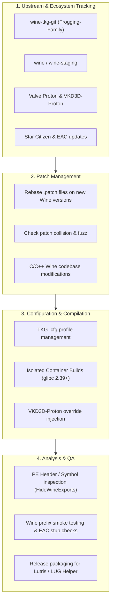
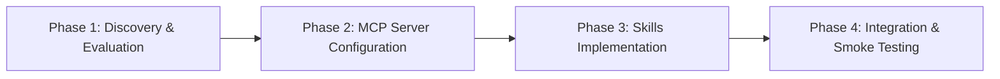

# Implementation Plan: Skills and MCP Servers for Wine-TKG Runner Development

## Executive Summary

This plan outlines the identification, evaluation, setup, and deployment of specialized **Agent Skills** and **Model Context Protocol (MCP) Servers** tailored for developing, maintaining, and debugging **Wine-TKG runners** for Star Citizen within the `lug-wine-experimental` environment.

---

## 1. Host System Profile & Compatibility Analysis

> [!IMPORTANT]
> **Host System Specifications Confirmed:**
> - **Operating System**: Ubuntu 22.04.5 LTS (Jammy Jellyfish)
> - **Linux Kernel**: `7.2.9-zabbly+ #ubuntu22.04 SMP PREEMPT_DYNAMIC` (Custom Zabbly mainline kernel)
> - **Host GLIBC Version**: **`2.35`** (`Ubuntu GLIBC 2.35-0ubuntu3.14`)
> - **Host Compiler**: GCC 11.4.0

### Critical Compatibility Analysis: GLIBC 2.35 vs GLIBC 2.39
- **Upstream Pre-built Runners**: Compiled in GitHub Actions (`.github/workflows/build-artifacts.yml`) on **Ubuntu 24.04**, with a hard minimum requirement of **`glibc >= 2.39`** (released 2024-01-31, as documented in [`README.md`](file:///workspaces/lug-wine-experimental/README.md)).
- **Binary Compatibility Reality**: Because Linux `glibc` is backward-compatible but **not forward-compatible**, pre-compiled release artifacts built on Ubuntu 24.04 will refuse to run on this host system, erroring out with missing glibc symbols (e.g. `version GLIBC_2.38 not found`).
- **Development & Build Strategy**:
  1. **Native Local Builds**: If we compile Wine locally on this host using [`build-lug-wine.sh`](file:///workspaces/lug-wine-experimental/build-lug-wine.sh), the resulting runner will link against **GLIBC 2.35**, allowing it to execute natively on this Ubuntu 22.04 system.
  2. **Release / CI Artifacts**: If building artifacts meant for the community repository targeting Ubuntu 24.04 (`glibc >= 2.39`), builds must be delegated to GitHub Actions or an isolated Ubuntu 24.04 container.
  3. **Kernel Advantages**: The custom **`7.2.9-zabbly+`** kernel delivers modern kernel primitives—including fast futex2 synchronization (`Fsync`), updated scheduler features, and recent GPU driver compatibility—giving high-performance capabilities for running Wine.

---

## 2. Domain Context & Workload Requirements

To identify the right tools, we map the core responsibilities involved in Wine-TKG runner engineering:

---

## 3. Required MCP (Model Context Protocol) Servers

MCP servers equip the agent with external protocol integrations, allowing it to interface directly with upstream repositories, isolated containers, system diagnostics, and web documentation.

| MCP Server | Provider / Package | Purpose in Wine-TKG Workflow | Priority |
| :--- | :--- | :--- | :--- |
| **Clangd C/C++ Code Intelligence MCP** | `felipeerias/clangd-mcp-server` / `tang-hi/clangd-mcp` | Provides semantic AST navigation, `find_definition`, `find_references`, header resolution, and real-time type diagnostics across Wine's multi-million line C codebase. | **Critical** |
| **GDB / LLDB Debugger MCP Server** | `smadi0x86/MDB-MCP` / `signal-slot/mcp-gdb` | Automated crash inspection: load core dumps, extract backtraces (`bt`), inspect registers/memory, and step through Wine/Proton crashes and segfaults. | **High** |
| **Compiler Diagnostics & Build Log Parser MCP** | Custom / Structured log analyzer | Ingests and parses massive parallel GCC/MinGW build logs from `build-lug-wine.sh`, isolating root compilation failures, `-Werror` breaks, and undefined linker symbols. | **High** |
| **GitHub MCP Server** | `@modelcontextprotocol/server-github` | Inspect commits, pull requests, releases, and CI runs across `Frogging-Family/wine-tkg-git`, `wine-staging`, `starcitizen-lug`, and `ValveSoftware/Proton`. | **Critical** |
| **Docker / Container MCP Server** | Community / Docker Engine socket | Launch ephemeral containers (e.g. `ubuntu:24.04`) to test build environments, resolve build dependencies, and run containerized test builds without host pollution. | **High** |
| **Git MCP Server** | `mcp-server-git` (or internal CLI) | Provide structured git log, branch comparison, diff analysis, and submodule pointer checks across `patches/` and `wine-tkg-git/`. | **High** |
| **Fetch / Web Search MCP Server** | `@modelcontextprotocol/server-fetch` / Brave Search | Research Wine bug reports, WineHQ AppDB, ProtonDB, Star Citizen Issue Council reports, and Linux kernel uapi updates (e.g., Ntsync). | **Medium** |
| **Filesystem / Memory Inspector MCP** | `@modelcontextprotocol/server-filesystem` | Provide scoped read/write access to staging areas, build outputs, and logs. | **Medium** |

---

## 4. Required Agent Skills (Procedural Capabilities)

Skills are reproducible, structured agent workflows housed in [`.agents/skills/`](file:///workspaces/lug-wine-experimental/.agents/skills/).

### Skill 1: `wine-patch-validator`
- **Objective**: Validate whether community `.patch` files apply cleanly against a designated upstream Wine or Wine-Staging commit/tag before initiating a full compilation.
- **Workflow**:
  1. Clone or checkout target Wine version in an isolated scratch directory.
  2. Run `git apply --check` or simulated dry-run for all patches in [`patches/wine/`](file:///workspaces/lug-wine-experimental/patches/wine).
  3. Detect rejected chunks (`.rej`), offsets, and fuzz.
  4. Output detailed diagnostics and propose rebased patch diffs.

### Skill 2: `tkg-config-auditor`
- **Objective**: Audit local LUG configuration files ([`config/lug-wine-tkg-*.cfg`](file:///workspaces/lug-wine-experimental/config)) against the latest upstream `wine-tkg-git` template (`customization.cfg`).
- **Workflow**:
  1. Fetch the latest `customization.cfg` from upstream `wine-tkg-git`.
  2. Parse and compare configuration keys.
  3. Flag deprecated options, renamed variables, or newly added performance switches (such as new Ntsync/Fsync variants or WOW64 options).
  4. Generate a config update recommendation report.

### Skill 3: `runner-binary-inspector`
- **Objective**: Verify binary integrity and compliance of compiled Wine runner output tarballs or directories before distribution.
- **Workflow**:
  1. Check binary architectures (`x86_64` vs `i386`) in `bin/` and `lib/wine/`.
  2. Inspect PE files using `winedump` or `objdump` to ensure dummy DLLs (`cryptbase.dll`, `nvngx.dll`) and export flags (`HideWineExports`) are active.
  3. Validate that `glibc` symbols comply with the minimum target requirement (`<= 2.39`).
  4. Verify presence and built-in linkage of `vkd3d-proton` libraries.

### Skill 4: `eac-and-prefix-verifier`
- **Objective**: Execute smoke testing inside an ephemeral test `WINEPREFIX` to ensure Star Citizen prerequisites initialize properly.
- **Workflow**:
  1. Initialize an ephemeral Wine prefix with the newly built runner.
  2. Verify registry entries (such as `reg_hide_wine.patch` modifications).
  3. Test loader invocation and verify that EAC stub binaries and locale fallbacks execute without crashes.
  4. Capture and summarize `WINEDEBUG` logs.

### Skill 5: `release-packager-and-hasher`
- **Objective**: Automate release generation, packaging verification, and checksum logging for LUG Helper.
- **Workflow**:
  1. Verify tarball structure conforms to Lutris runner directory layout.
  2. Generate SHA256 checksums and file size metadata.
  3. Prepare GitHub Release notes formatted with patch lists and Wine version milestones.

### Skill 6: `c-build-and-patch-debugger`
- **Objective**: Triage and resolve C compilation errors, type discrepancies, and linker failures occurring during Wine/MinGW compilation.
- **Workflow**:
  1. Ingest compiler error logs (e.g., `error: implicit declaration of function`, `error: incompatible pointer type`, `undefined reference to ...`).
  2. Locate the offending header, C translation unit, or `.spec` export file.
  3. Analyze the patch that introduced or modified the code.
  4. Generate a clean, conforming C code fix that honors Wine API conventions (e.g. `WINAPI`, NT status codes, `winedbg` stubs).

### Skill 7: `wine-crash-trace-analyzer`
- **Objective**: Parse Wine crash dumps, unhandled page faults (`0xc0000005`), and `WINEDEBUG` channel logs.
- **Workflow**:
  1. Ingest crash logs generated by `winedbg` or core dumps.
  2. Trace stack frames back through `wineserver`, `ntdll.so`, `winevulkan.dll`, or game binaries.
  3. Cross-reference unhandled syscalls or stubbed functions (`fixme:` logs) against active patches.
  4. Output actionable debugging recommendations or necessary patch adjustments.

---

## 5. Step-by-Step Execution Roadmap

### Phase 1: Tool Discovery & Evaluation (Days 1–2)
1. **Catalog Upstream Dependencies**: Identify current versions of `wine-tkg-git`, `vkd3d-proton`, and target Wine tags.
2. **Review Available MCP Ecosystem**:
   - Verify compatibility of `@modelcontextprotocol/server-github` and container tooling with current devcontainer environment.
   - Determine whether local CLI execution vs MCP socket is preferable for specific git/docker operations.

### Phase 2: MCP Server Setup & Configuration (Days 3–4)
1. **Configure Code Intelligence MCP**:
   - Set up Clangd MCP server (`clangd-mcp-server`) with `compile_commands.json` generation support.
2. **Configure Debugging & Diagnostics MCP**:
   - Set up GDB/LLDB MCP server (`smadi0x86/MDB-MCP`) for core dump inspection and crash analysis.
3. **Configure GitHub & Container MCP**:
   - Configure GitHub MCP token for watched upstream repos.
   - Configure Docker MCP for isolated `ubuntu:24.04` build verification.

### Phase 3: Skill Authoring in `.agents/skills/` (Days 5–7)
1. Create `wine-patch-validator/` (patch syntax, collision, and reject checks).
2. Create `tkg-config-auditor/` (diffing configuration options against upstream).
3. Create `c-build-and-patch-debugger/` (resolving compiler/linker errors and Wine spec files).
4. Create `wine-crash-trace-analyzer/` (interpreting `WINEDEBUG` logs and GDB backtraces).
5. Create `runner-binary-inspector/` and `release-packager-and-hasher/`.

### Phase 4: Integration Verification (Day 8)
1. Perform dry-run validation using the newly authored skills on an existing patch from [`patches/wine/`](file:///workspaces/lug-wine-experimental/patches/wine).
2. Validate that the strict agent rules ([`.agents/rules/rules.md`](file:///workspaces/lug-wine-experimental/.agents/rules/rules.md)) are honored during all automated procedures.
3. Update session memory in [`.agents/memory/MEMORY.md`](file:///workspaces/lug-wine-experimental/.agents/memory/MEMORY.md).
